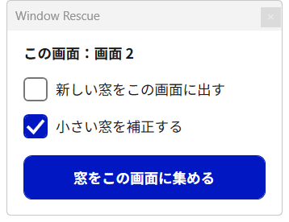

# Window Rescue

見えない位置や操作できないサイズで開いたウインドウを、今使っている画面へ救出する Windows 11 用の常駐アプリ。

## こんなときに

- 取り外したディスプレイの位置にアプリが開いて、どこにも見えない
- 別の PC へ入力を切り替えた画面に、新しい窓やダイアログが出てしまう
- 極端に小さいサイズで開いて、起動していることに気付けない
- あちこちの画面に散らばった窓を、手元の画面へまとめたい

## 主な機能

- **ミニウインドウ**：置いた画面を「この画面」として、次の 3 つを操作
  - 新しい窓をこの画面に出す（ミニウインドウを動かすと表示先も追従）
  - 小さい窓を補正する（オンにした時点で、開いている極小の窓も補正）
  - 窓をこの画面に集める
- **ウインドウ一覧**：画面外や極小の窓も文字で探して、選んだ窓だけを救出
- **ショートカット・トレイ・デスクトップの右クリックメニュー**から一括救出
- **デスクトップの右クリックメニュー**から操作できるため、タスクバー（トレイ）が見えない画面でも、その場で窓を集めたりミニウインドウを呼び出したりできる
- 最小化・最大化の状態を保ったまま移動。画面ごとの拡大率（DPI）の違いにも対応
- 日本語／English の切り替え。デジタル庁デザインシステム（DADS）を基準にした画面

## ダウンロード・動作環境

[Releases](https://github.com/fa-yoshinobu/window-rescue/releases) から `WindowRescue-win-x64.zip` を取得・展開し、`WindowRescue.exe` を実行します。ファイル名は版によらず同じなので、更新するときはアプリを終了して exe を上書きするだけです（設定は引き継がれます）。

最新版の直接リンク：<https://github.com/fa-yoshinobu/window-rescue/releases/latest/download/WindowRescue-win-x64.zip>

- Windows 11（x64）
- インストール不要。.NET も同梱しているため、別途インストールする必要はありません
- 設定はこの PC 内（`%LOCALAPPDATA%\WindowRescue`）だけに保存し、外部への通信はしません

## 使い方

1. `WindowRescue.exe` を起動すると、通知領域（トレイ）に常駐してミニウインドウが表示されます（既存の窓は動かしません）
2. 窓を集めたい画面へミニウインドウを置き、「窓をこの画面に集める」を押します
3. 新しい窓をその画面に出したいときは「新しい窓をこの画面に出す」にチェックを入れます

タスクバーのある画面が見えないとき（入力を別の PC へ切り替えた場合など）は、見えている画面のデスクトップを右クリックし、「その他のオプションを確認」→「ウインドウ救出」から操作できます。この機能は設定の「右クリックメニュー」で登録すると使えます。

詳しくは [使い方](docs/usage.md) を参照してください。

## ドキュメント

- [使い方](docs/usage.md)
- [開発・ビルド・リリース](docs/development.md)
- [変更履歴](CHANGELOG.md)
- [TODO](TODO.md)

## ライセンス

[MIT License](LICENSE) © 2026 FA Labo

## Release distribution

The fixed-name ZIP and checksum links below are available for the current release. Older releases retain their original assets.

- [Latest Windows x64 ZIP](https://github.com/fa-yoshinobu/window-rescue/releases/latest/download/WindowRescue-win-x64.zip)
- [ZIP SHA-256 checksum](https://github.com/fa-yoshinobu/window-rescue/releases/latest/download/WindowRescue-win-x64.zip.sha256)
- [Changelog](CHANGELOG.md) / [TODO](TODO.md)

Extract the ZIP file, then run `WindowRescue.exe`.

Windows 11 (x64). The .NET runtime is included.

Release notes and VirusTotal scan messages are in English. Existing project documents may keep their current language.

Maintainers: update the English Changes section in `.github/release-notes.md` from the relevant CHANGELOG entries before releasing. The release workflow publishes the ZIP and checksum, then scans the actual published executables. Use the `Scan release with VirusTotal` workflow with a release tag to retry an incomplete scan. See the [shared release standard](https://github.com/fa-yoshinobu/release_standard).
